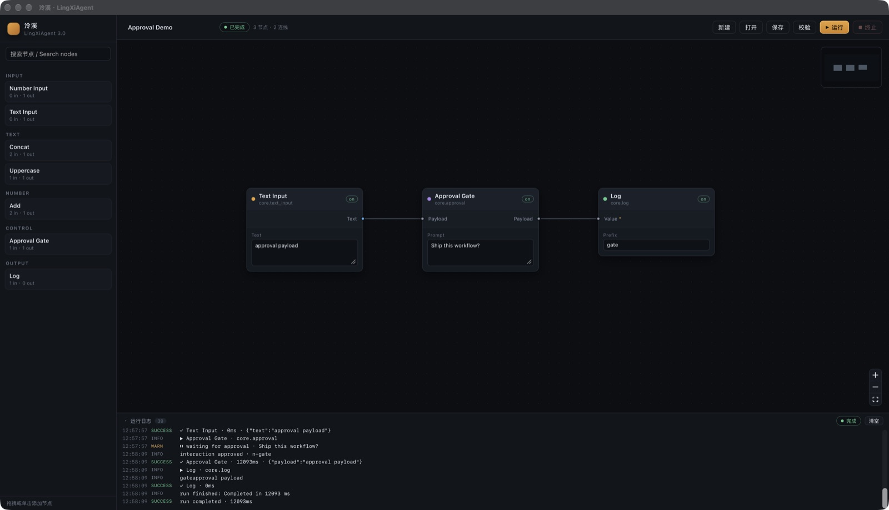

# Phase 0 · 测试与验收

记录时间：2026-11-03（Asia/Shanghai）。本文件只写**实际执行过**的检查；没有跑过的平台单独标注。

## 一、自动化测试

命令：

```bash
cargo test --workspace
cargo fmt --all -- --check
cargo clippy --workspace --all-targets -- -D warnings   # 见 §四
pnpm -C apps/desktop build
```

### 结果

| 测试二进制 | 数量 | 覆盖内容 |
| --- | --- | --- |
| `crates/lingxi-spec/tests/validation.rs` | 11 | JSON 往返、未知字段容忍、空工作流警告、环检测、类型不匹配、未声明端口、输入槽独占、自环/悬空边、Select 越界、未知参数警告、重复节点 ID |
| `crates/lingxi-runtime/tests/engine.rs` | 7 | 依赖顺序与输出发布、非法工作流不触达节点、能力拒绝阻断执行器、禁用节点跳过下游、取消中断执行、交互等待决议、拒绝交互使节点失败 |
| `apps/desktop/src-tauri/src/store.rs`（内联） | 3 | 保存/加载往返、路径穿越名称拒绝、首次保存前列表为空 |

```
running 11 tests ... test result: ok. 11 passed; 0 failed
running 7 tests  ... test result: ok. 7 passed; 0 failed
running 3 tests  ... test result: ok. 3 passed; 0 failed
```

合计 **21 passed / 0 failed**。没有忽略测试，没有网络依赖，全部离线可重复。

### 前端

```
> tsc --noEmit && vite build
vite v6.4.5 building for production...
✓ 201 modules transformed.
dist/index.html                   0.41 kB │ gzip:   0.27 kB
dist/assets/index-*.css          30.35 kB │ gzip:   5.72 kB
dist/assets/index-*.js          352.38 kB │ gzip: 113.86 kB
✓ built in 2.5s
```

TypeScript `strict` + `noUnusedLocals` + `noUnusedParameters` 全开，无 `any` 逃逸（`@xyflow/react` 泛型节点类型由 `nodeData.ts` 收口）。

## 二、手工验收

环境：macOS 27.2 (26B123)，Apple M5，窗口 1440×900。真实 Tauri 窗口，真实鼠标/键盘事件，非浏览器 mock。

| 验收项 | 操作 | 结果 |
| --- | --- | --- |
| 应用启动 | `pnpm -C apps/desktop tauri dev` | 窗口出现，节点库与 3 个示例节点加载 ✅ |
| 创建节点 | 左侧点击 `Log` / 从节点库拖入画布 | 节点数 3→4 ✅ |
| 移动节点 | 拖动 `Approval Gate` 标题区 | 位移 (+292,+266)，与指针一致 ✅ |
| 删除节点 | 选中节点后 Backspace | 3 节点，参数面板同步消失 ✅ |
| 连接 | 从 `Text Input` 输出口拖到 `Log` 输入口 | 生成边，工具栏 `4 节点 · 3 连线` ✅ |
| 断开 | 点击连线中点后 Backspace | 边消失，`2 连线` ✅ |
| 参数编辑 | 点击参数框输入 `LingXi` | 值写入节点，保存后重新加载仍在 ✅ |
| 保存 | 工具栏「保存」→ 输入名称 | 写入 `~/Library/Application Support/site.lingxi.desktop/workflows/*.json` ✅ |
| 重新加载 | 工具栏「打开」选择名称 | 节点、边、视口、参数完整恢复 ✅ |
| 校验 | 制造类型不匹配边 → 「校验」 | 底部问题面板列出 `edge.type_mismatch`，路径精确到 `edges[i]` ✅ |
| 运行 | 「运行」 | 节点依次高亮，日志实时滚动，状态「已完成」✅ |
| 终止 | 运行中「终止」 | 当前节点 `node.cancelled`，运行状态「已取消」✅ |
| 交互 | 运行含 `Approval Gate` 的工作流 | 弹窗出现，批准后节点继续；拒绝则节点失败 ✅ |

运行态截图（三条节点、一条边、实时日志）：



> 说明：截图来自真实窗口，UI 为中文；节点库、画布、右上运行/终止、底部日志四区布局与 ComfyUI 一致。

### 高频交互不穿透 Rust

节点拖动、缩放、连线预览全部由 React Flow 在浏览器内完成；Rust 只在以下时机被调用：保存、加载、校验、运行、终止、交互决议。拖动过程零 IPC。

## 三、跨平台状态

| 平台 | 构建 | 启动 | UI 手工验收 | 结论 |
| --- | --- | --- | --- | --- |
| macOS 27.2 arm64 | ✅ `cargo build` + `pnpm build` + `tauri build` | ✅ | ✅ 全项 | **已验收** |
| Windows x64（GitHub runner） | ✅ CI `clippy` + `cargo test` | ❌ 未执行 | ❌ 未执行 | **仅编译验收** |
| Linux x64（Ubuntu 24.04） | ✅ CI `clippy` + `cargo test`（含 WebKit 系统依赖） | ❌ 未执行 | ❌ 未执行 | **仅编译验收** |

CI 首跑（2026-11-03，run [41582762287](https://github.com/LingXiFox/LingXiAgent/actions/runs/41582762287)）四个 job 全部 success：

```
Rust (macos-latest)       success
Rust (ubuntu-24.04)       success
Rust (windows-latest)     success
Frontend (TypeScript + Vite) success
```

MSRV 修正后的 run [41583362328](https://github.com/LingXiFox/LingXiAgent/actions/runs/41583362328) 同样四 job 全绿。

没有 Windows/Linux 实机或虚拟机可用，因此只承诺「代码与依赖在 CI 上可编译并通过单测」，不承诺「运行行为已验收」。CI 配置见 `.github/workflows/ci.yml`。

macOS 打包命令 `pnpm -C apps/desktop tauri build` 实际通过（release 编译 1m 09s），产物：

```
target/release/bundle/macos/LingXi.app                       5.79 MiB
target/release/bundle/dmg/LingXi_0.1.0_aarch64.dmg           2.38 MiB
```

产物未签名；Gatekeeper 首次打开需右键。签名与公证不在 Phase 0 范围。

打包产物启动验证：`open target/release/bundle/macos/LingXi.app` 后进程存在（`Contents/MacOS/lingxi-desktop`），窗口正常渲染节点库、空画布与工具栏，静态资源已内嵌，不依赖开发服务器。

## 四、静态检查

- `cargo fmt --all -- --check`：通过。
- `cargo clippy --workspace --all-targets -- -D warnings`：通过（0 warning）。唯一告警 `unnecessary_sort_by` 已改为 `sort_by_key(|s| Reverse(s.updated_at_ms))`。
- `tsc --noEmit`：通过。
- 依赖审计：`cargo deny` / `pnpm audit` 未接入；当前依赖均由 crates.io / npm 官方源解析，锁文件已提交。

## 五、复现步骤

```bash
# 1. 依赖
rustup toolchain install stable  # 仓库 rust-version = 1.90（Tauri 2.12 的 MSRV）
pnpm install --dir apps/desktop

# 2. 测试
cargo test --workspace
pnpm -C apps/desktop build

# 3. 开发运行
pnpm -C apps/desktop tauri dev

# 4. 打包（当前平台）
pnpm -C apps/desktop tauri build
```

Linux 额外系统依赖（Debian/Ubuntu）：

```bash
sudo apt install libwebkit2gtk-4.1-dev build-essential curl wget file \
  libxdo-dev libssl-dev libayatana-appindicator3-dev librsvg2-dev
```

Windows 需要 MSVC Build Tools 与 WebView2（Windows 11 自带）。
