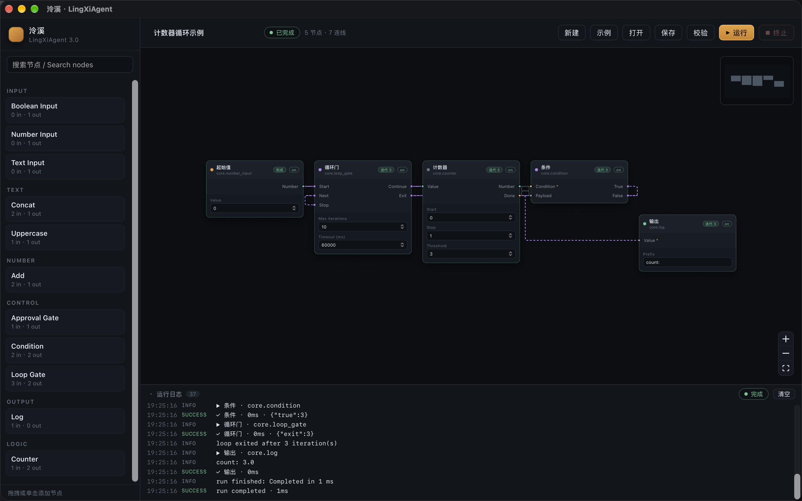
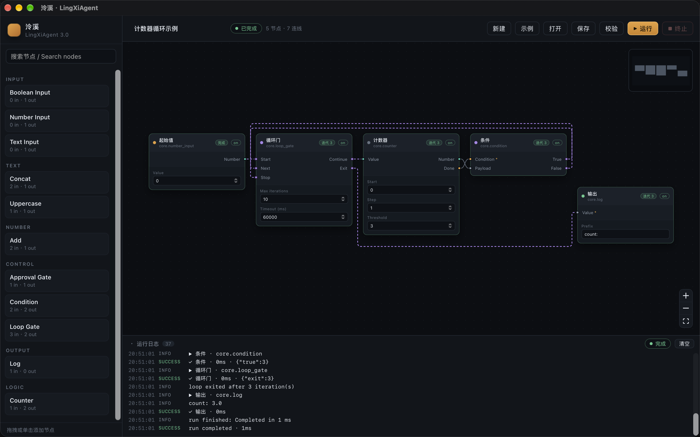
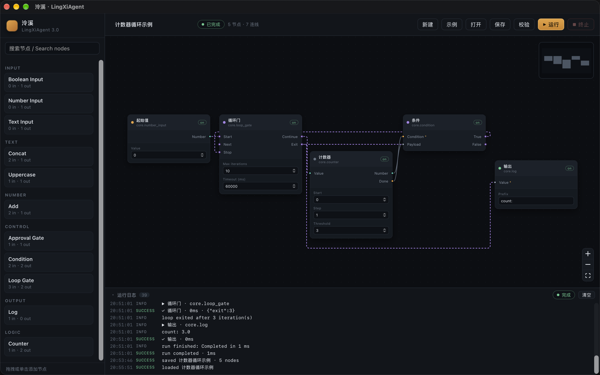
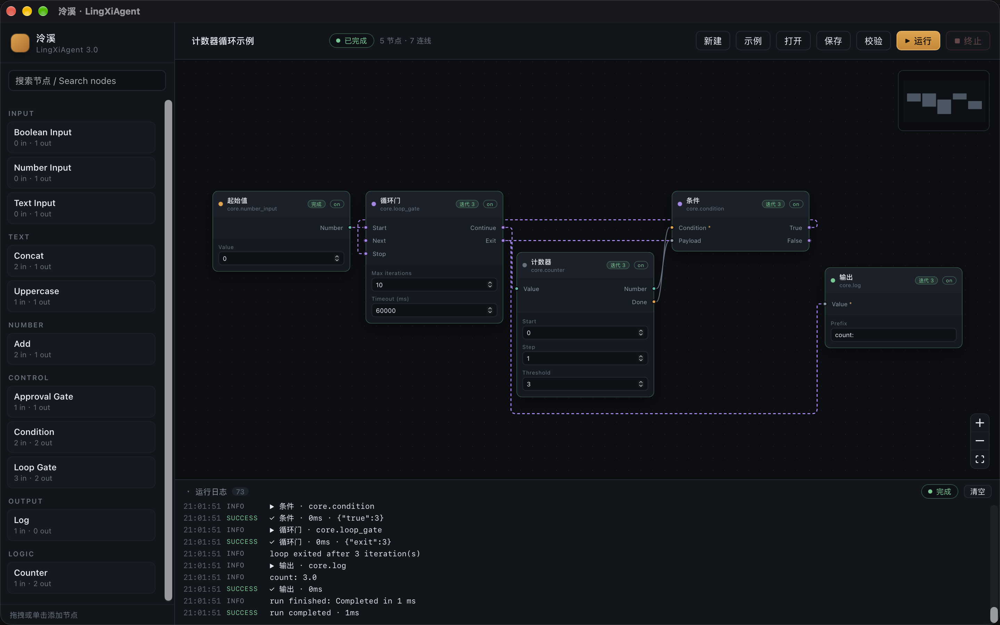

# Phase 1.1.1 · 测试与验收记录

状态：前端路由实现完成；Rust 工作区 36/36、前端路由 13/13、Vite 构建通过；macOS Tauri 实机验收通过；Windows/Linux 仅 CI 编译，未做运行时视觉验收。
日期：2026-11-03。基线提交：`1b366f5`（Phase 1.1 完成）。

## 一、验收范围

| 项目 | 结果 |
| --- | --- |
| 自定义路由器替换 smoothstep | 通过 |
| 使用实测节点矩形与 14px 安全边距 | 通过 |
| 正向、反向、跨节点连接 | 通过 |
| 正交路径圆角 | 通过 |
| 无解时安全 fallback，不静默丢边 | 通过 |
| data 实线 / control 紫色虚线 | 通过 |
| 平行边车道分离 | 通过 |
| 拖拽、缩放、保存、重载稳定 | 通过（macOS Tauri） |
| 自动无穿模测试 | 通过（60 组随机图 + 固定用例） |
| 执行行为不变 | 通过（真实 Rust，迭代 3） |
| 100 / 500 / 1000 节点基准 | 通过 |
| Windows / Linux 运行时视觉验收 | **未验收**（仅 CI 编译） |

## 二、自动化测试

### 2.1 前端路由

命令：

```bash
pnpm --dir apps/desktop test:routing
```

结果：`13 pass / 0 fail`，Node v26.13.0。

| # | 用例 | 断言 |
| --- | --- | --- |
| 1 | 相邻节点、正向、无障碍 | 采用 `smooth`，`fallback = false` |
| 2 | 障碍物挡在直线路径 | 改走正交绕行，`blocked = 0` |
| 3 | 目标在源左侧 | 不产生回勾曲线，走外侧正交路径 |
| 4 | 不同 lane 的平行边 | 路径不重合 |
| 5 | 正交路径 | 含 `Q` 圆角段，起点/终点精确 |
| 6 | 多行反向连接 | 路径不穿任何节点矩形 |
| 7 | 同源同目标、多端口 | lane 偏移不同，边分离 |
| 8 | 60 组合法随机布局（端口不在障碍物内部） | 全部无 fallback，`blocked = 0` |
| 9 | 端口落在障碍物内部 | 明确 `fallback = true`，`blocked > 0`，仍渲染路径 |
| 10 | Phase 1.1 真实 demo 几何 | 3 条控制边均无 fallback，路径类型符合预期 |
| 11 | 28px 相邻节点间隙 | 逃逸点单调且不进入对侧节点 |
| 12 | 更窄间隙 | 逃逸长度继续收缩，不越界 |
| 13 | 只进入安全边距、未穿模 | 记为 `clearance`，不算 `blocked` |

### 2.2 Rust 回归

命令：

```bash
cargo test --workspace
```

结果：36/36 通过（spec 19、runtime 14、desktop store 3）。Phase 1.1.1 未改 Rust，执行语义、控制流校验、循环预算保持原状。

### 2.3 构建

- `pnpm --dir apps/desktop build`：通过，205 modules，JS 368.58 kB（gzip 119.47 kB）。
- `cargo fmt --all -- --check`、`cargo clippy --workspace --all-targets -- -D warnings`：通过（提交前复跑）。

## 三、性能基准

命令：

```bash
pnpm --dir apps/desktop bench:routing
```

环境：Apple Silicon macOS，Node v26.13.0，单进程冷启动，一次运行。数字是工程参考，不是跨平台承诺。

| 节点 | 边 | 索引构建 | 冷路由 | 单边 | 热缓存 | 单边 | fallback | smooth / orthogonal |
| ---: | ---: | ---: | ---: | ---: | ---: | ---: | ---: | --- |
| 100 | 171 | 4.2 ms | 6.9 ms | 0.040 ms | 1.5 ms | 0.009 ms | 0 | 92 / 74 |
| 500 | 947 | 0.4 ms | 27.0 ms | 0.029 ms | 6.7 ms | 0.007 ms | 0 | 482 / 442 |
| 1000 | 1895 | 0.5 ms | 44.5 ms | 0.023 ms | 12.3 ms | 0.007 ms | 0 | 975 / 920 |

100 节点首轮索引 4.2ms 含 JIT/预热；后续规模反而降到亚毫秒。拖拽时只有源/目标节点坐标变化，路由缓存 key 随之变化，未命中边继续复用热缓存；缩放在 flow 坐标下不触发重算。

## 四、真实 macOS Tauri 验收

环境：macOS Apple Silicon，`pnpm tauri dev`，窗口 `281,107 1440x901`，进程 `lingxi-desktop`。

### 4.1 加载与静态检查

- 点击“示例”：5 节点 / 7 连线，日志 `loaded demo workflow · counter → condition → loop gate`。
- 浏览器控制台探针：7 条边全部 `fallback: false`。
  - `seed.number -> gate.start`：orthogonal
  - `gate.continue -> counter.value`：smooth
  - `counter.number -> condition.payload`：smooth
  - `counter.done -> condition.condition`：smooth
  - `condition.true -> gate.stop`：orthogonal
  - `condition.false -> gate.next`：orthogonal
  - `gate.exit -> log.value`：orthogonal
- 控制台无 fallback 警告。

### 4.2 执行不变

点击“运行”，真实 Rust Runtime：

- 状态：`已完成`
- Loop Gate / Counter / Condition / Log 徽标：`迭代 3`
- 日志：`condition {"true":3}`、`gate exit {"exit":3}`、`loop exited after 3 iteration(s)`、`count: 3.0`、`run completed · 1ms`
- 旧输出没有残留；Condition 未选中的 `false` 分支未执行、未报错。

截图：`Docs/phase-1.1.1/assets/after-smart-routing.png`，即运行完成且适配视图后的最终状态。

### 4.3 拖拽重路由

- 用真实鼠标把 Counter 标题栏从屏幕 `1100,390` 拖到 `1100,510`，Counter 的 flow 坐标从 `(576,160)` 变为 `(576,272)`。
- 拖后控制台探针仍为 7 条边全部 `fallback: false`；`gate.continue` 改走正交，Condition 两条反向边改走外侧。
- 截图：`Docs/phase-1.1.1/assets/counter-drag-reroute.png`。

### 4.4 保存与重载

- 点击“保存”：提示 `已保存`，日志 `saved 计数器循环示例 · 5 nodes`。
- 落盘：`/Users/lingxifox/Library/Application Support/site.lingxi.desktop/workflows/计数器循环示例.json`，Counter 为 `x: 576, y: 272`，7 条边不变。
- 点击“打开” → 第一行“计数器循环示例” → “载入”：5 节点 / 7 连线，Counter 仍在 `y: 272`，日志 `loaded ...`。
- 重载后再次点击“运行”：状态 `已完成`，四个节点仍显示 `迭代 3`，日志 `loop exited after 3 iteration(s)`、`count: 3.0`、`run completed · 1ms`。
- 截图：`Docs/phase-1.1.1/assets/reload-saved.png`（重载后）、`Docs/phase-1.1.1/assets/run-after-reload.png`（重载并再次运行）。

### 4.5 前后对比

| 之前（默认 smoothstep） | 之后（smart router） |
| --- | --- |
|  |  |

之前：Condition 两条反向边在节点左侧折回、末端悬空；`gate.exit -> log` 直接穿过 Counter。
之后：所有边从端口出发、绕开节点、圆角正交，控制边紫色虚线，执行结果不变。

拖拽重路由：


重载后：



重载并再次运行（Counter 保持拖拽后的位置）：



## 五、视觉与边界说明

- 在 fit 缩放约 0.68 下，两条反向控制边与底部 `exit` 边围成一个较大的虚线矩形。路径确实留出 14px 安全边距、没有穿节点，但观感偏“电路板”。这是严格避障 + 端口出发的取舍，未为了“好看”让边穿节点。
- Condition 的两个输入端口与 Counter 的两个输出端口顺序相反，两条 data 边在两节点之间形成一个小交叉（bowtie）。要消除它需要显著绕远，当前接受边与边交叉。
- 无解时 fallback 会降透明度、加 title、打 `console.warn`；不会删除边或伪造成功。真实 demo 与 60 组合法随机布局未出现 fallback；端口落在障碍物内部时按预期 fallback。
- 路由是纯前端行为，不改工作流 JSON 的语义字段，只写 `type: "smart"` 和既有 `data.control`。

## 六、已知问题

1. 重载后状态胶囊仍显示上一次的“已完成”，但节点迭代徽标已清空。该问题在 Phase 1.1.1 之前就存在，与路由无关，本阶段未修。
2. 边与边交叉不做全局优化；密集图可能出现多条平行虚线视觉拥挤。
3. 没有手工折点、边捆绑、锚点拖拽；端口被障碍物完全包围时只能 fallback。
4. Windows / Linux 仅通过 CI 的 Rust 编译、单测和前端构建；真实窗口、拖拽、缩放、保存重载未在对应系统验收，不能标记为“已验收”。

## 七、复现命令

```bash
# Rust
cargo fmt --all -- --check
cargo clippy --workspace --all-targets -- -D warnings
cargo test --workspace

# Frontend
pnpm --dir apps/desktop build
pnpm --dir apps/desktop test:routing
pnpm --dir apps/desktop bench:routing

# Tauri (macOS)
pnpm tauri dev
```

验收结论：前端路由替换、避障、反向边、拖拽重路由、保存重载与执行回归均通过；未实测平台已明确标记。
