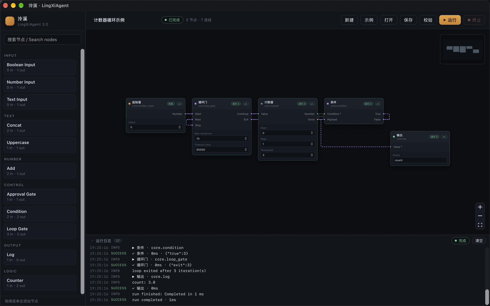

# Phase 1.1 测试与验收

状态：实现完成。Rust 自动化测试、前端构建和 macOS 实机 Tauri 验收已通过；Windows/Linux 只验证了 CI 编译与单元测试，运行行为未验收。

## 一、范围

本阶段验收条件分支、受控循环、重复激活、静态循环校验、最小 UI 适配和真实 Tauri 执行链路。不包含 LLM、MCP、Skills、并行调度与持久化运行状态。

## 二、实测环境

| 项 | 值 |
| --- | --- |
| 主机 | macOS 27.2（Build 26B123），Apple Silicon |
| Rust | rustc 1.99.1 / cargo 1.99.1（Homebrew） |
| Node | v26.13.0 |
| pnpm | 9.15.9 |
| Tauri | 2.x（`apps/desktop/src-tauri`） |
| React | 18.3.1 |
| React Flow | `@xyflow/react` 12.x |
| 分支 | `rewrite/3.0` |

## 三、自动化检查

以下命令均在仓库根目录执行并已通过：

```bash
cargo fmt --all -- --check
cargo clippy --workspace --all-targets -- -D warnings
cargo test --workspace
pnpm --dir apps/desktop build
```

结果：

- `cargo fmt`：通过。
- `cargo clippy`：通过，0 warning。
- `cargo test --workspace`：36 passed，0 failed。分布为 `lingxi-spec` 校验测试 8 + 11，`lingxi-runtime` 控制流 7 + 引擎 7，`lingxi-desktop` 存储 3。
- 前端：TypeScript 类型检查与 Vite 生产构建通过。

## 四、验收项与测试映射

| # | 验收项 | 自动化测试 | 结果 |
| --- | --- | --- | --- |
| 1 | 普通 DAG 无回归 | `runs_dependencies_in_order_and_publishes_outputs`、`disabled_nodes_skip_their_dependents`、`capability_denial_blocks_the_executor`、`invalid_workflows_never_reach_a_node` 及 Phase 0 校验测试 | 通过 |
| 2 | Condition 为 true 时只执行 true 分支 | `condition_true_runs_only_the_true_branch`，并断言另一分支进入 `skipped_nodes` 且不失败 | 通过 |
| 3 | Condition 为 false 时只执行 false 分支 | `condition_false_runs_only_the_false_branch`，同样断言未选分支被跳过 | 通过 |
| 4 | 循环 3 次后退出 | `counter_loop_runs_three_iterations_then_exits`，Counter 输出严格为 1/2/3，Gate 迭代序列为 1,2,3,3 | 通过 |
| 5 | 无 exit 路径的循环被拒绝 | `a_loop_without_an_exit_edge_is_rejected`（`loop.no_exit_path`） | 通过 |
| 6 | 绕过 Loop Gate 的闭环被拒绝 | `a_feedback_path_that_bypasses_the_gate_is_rejected`（`loop.uncontrolled_cycle`） | 通过 |
| 7 | 预算耗尽导致失败而非静默退出 | `budget_exhaustion_fails_the_run`，`loop.budget_exhausted`，且只执行到预算上限 | 通过 |
| 8 | 循环中取消可中断 | `cancellation_interrupts_a_running_loop`，5 秒内结束并产生 `NodeCancelled` | 通过 |
| 9 | 循环体节点失败导致运行失败 | `a_node_failure_inside_a_loop_ends_the_run`，且只产生一个 `RunFinished` | 通过 |
| 10 | 每次迭代读取最新值、无陈旧输出 | `counter_loop_runs_three_iterations_then_exits` 的 Counter 输入/输出序列；每次激活重新取值 | 通过 |

补充测试：`a_gate_without_an_explicit_budget_is_rejected`、`an_acyclic_gate_without_a_budget_is_rejected`、`a_zero_iteration_budget_is_rejected`、`a_gate_without_a_start_trigger_is_rejected`、`a_control_port_requires_a_control_edge`、`edges_without_a_kind_deserialize_as_data_edges`、`timeout_fails_the_run`。

## 五、校验码

Phase 1.1 在 Phase 0 的 20 个稳定校验码上新增 6 个，共 26 个：

| 校验码 | 级别 | 触发条件 |
| --- | --- | --- |
| `edge.control_required` | Error | branch 或 loop gate 的控制输出边不是 `control` 类型 |
| `loop.multiple_gates` | Error | 同一个 SCC 内出现多个 Loop Gate |
| `loop.uncontrolled_cycle` | Error | 移除 Gate 后 SCC 内仍有环，存在绕过 Gate 的反馈路径 |
| `loop.no_exit_path` | Error | Gate 的 `exit` 没有指向 SCC 外的出边 |
| `loop.missing_trigger` | Error | Gate 缺少 `start` 或 `next` 入边 |
| `loop.invalid_budget` | Error | `maxIterations` 或 `timeoutMs` 缺失、非整数、非正或越界 |

上限：`maxIterations <= 1_000_000`，`timeoutMs <= 86_400_000`（24 小时）。预算必须显式写入工作流，校验器与 Runtime 不使用隐式默认值。

运行期错误码另有 `loop.budget_exhausted`、`loop.timeout`、`loop.invalid_state`、`loop.missing_trigger`，不混入静态校验报告。

## 六、macOS 实机验收

环境：macOS 27.2，Tauri 2 桌面窗口，真实 Rust Runtime（非 mock）。

1. 启动 `pnpm tauri dev`，桌面窗口正常显示四区布局。
2. 点击「示例」加载 Counter → Condition → Loop Gate → Log 演示，画布为 5 节点 / 7 控制边。
3. 点击「运行」，状态变为「已完成」；Gate、Counter、Condition、Log 均显示「迭代 3」，Log 输出 `count: 3.0`。
4. 日志按时间顺序显示每轮 `条件`、`循环门`、`输出` 事件，并输出 `loop exited after 3 iteration(s)`、`run completed · 1ms`。
5. 点击「保存」写入 `计数器循环示例`；点击「打开」可看到该工作流并重新载入。
6. 重新载入后画布恢复 5 节点 / 7 连线，无残留运行徽标；再次运行结果一致。
7. 点击「新建」或「示例」时，非空画布弹出应用内确认框；确认后清空或替换。原 `window.confirm` 在 Tauri WKWebView 中不可用，已替换为 `ConfirmDialog`。

截图：`assets/phase-1.1-loop-demo.png`。



## 七、跨平台状态

| 平台 | 编译 | 单元测试 | 桌面运行 | 结论 |
| --- | --- | --- | --- | --- |
| macOS (Apple Silicon) | 通过 | 36/36 | 已实机验收 | 通过 |
| Ubuntu 24.04 | CI 配置覆盖 | CI 配置覆盖 | 未实测 | 仅编译与单测，运行未验收 |
| Windows (x64) | CI 配置覆盖 | CI 配置覆盖 | 未实测 | 仅编译与单测，运行未验收 |

CI 矩阵为 `macos-latest`、`ubuntu-24.04`、`windows-latest`，执行 fmt（Linux）、clippy、全 workspace 测试；前端单独执行 `pnpm build`。CI 不启动桌面窗口，因此不能替代运行期验收。

## 八、已知限制

- 调度器顺序执行节点；同一层的独立分支按稳定顺序依次运行，没有并行执行与并行取消语义。
- 每个 SCC 只允许一个 Loop Gate，不支持嵌套循环。循环体内的分支必须在 Gate 处汇合，不能各自驱动独立循环。
- Condition 只有 true/false 两个分支；多分支路由留待后续版本。
- 循环预算必须显式配置，且受 1,000,000 次 / 24 小时上限约束；不支持无限循环。
- 运行状态保存在内存中；应用崩溃或重启后无法恢复未完成运行。
- 取消通过 drop 正在执行的 future 实现。未来接入真实工具或模型时，executor 必须保证取消安全，外部副作用需要自行清理或幂等。
- 控制边与数据边严格区分；普通数据边不隐式决定执行时序。把控制输出接到数据输入会被校验拒绝。
- 跳过的分支会在运行摘要中标记，但当前 UI 不显示「已跳过」徽标，只显示未运行。
- 本阶段没有真实 LLM 推理、MCP、Skills、插件市场或动态节点加载。
- Windows/Linux 的窗口行为、文件对话框与 WebView 差异未做人工验收。

## 九、结论与下一步

控制流、循环预算、取消、失败传播和 DAG 回归均有自动化测试覆盖，macOS 实机链路闭环。下一阶段建议优先补 Windows/Linux 实机冒烟、循环嵌套策略、并行分支调度与插件节点加载，再进入 LLM Provider 与资源权限层。
