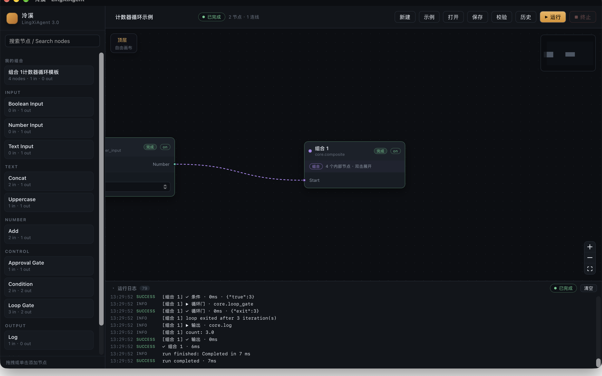

# Phase 1.3 · 测试与验收

状态：已实现，macOS 真实 Tauri 全项通过；Windows / Linux 仅通过 CI 编译、Clippy 与单元测试，运行行为**未验收**。
验收日期：2026-11-04。
对应设计：[01-design.md](01-design.md)。

## 一、验收环境

| 项 | 值 |
| --- | --- |
| 机器 | macOS Apple Silicon |
| 系统 | macOS 27.3（26C5035r） |
| Rust | rustc 1.99.1 / cargo 1.99.1（Homebrew） |
| Node | v26.13.0 |
| pnpm | 9.15.9 |
| 分支 | `rewrite/3.0` |
| 基线提交 | `dc7dae6`（Phase 1.2.1 收尾） |
| 启动方式 | `pnpm --dir apps/desktop tauri dev`，真实 Tauri WebView + Rust IPC |



## 二、自动化结果

### Rust

```bash
cargo fmt --all -- --check
cargo clippy --workspace --all-targets -- -D warnings
cargo test --workspace
```

结果：格式与 Clippy 无告警；**77 passed, 0 failed**。

| 测试目标 | 数量 |
| --- | --- |
| `composite`（子图运行时集成） | 10 |
| `control_flow`（条件/循环调度） | 7 |
| `engine`（DAG 与失败/取消） | 7 |
| `event_sequence`（序号与终态） | 2 |
| `subgraph_validation`（子图协议静态校验） | 9 |
| `control_flow_validation`（循环/控制边规则） | 8 |
| `validation`（基础文档校验） | 12 |
| `lingxi-desktop` 单元测试（存储/脱敏/模板等） | 22 |

新增的子图运行时测试：

- `a_wrapped_dag_produces_the_same_outputs`
- `multiple_ports_map_in_and_out`
- `an_inner_failure_propagates_to_the_composite`
- `cancellation_interrupts_an_inner_node`
- `multiple_instances_keep_independent_state`
- `a_loop_inside_a_composite_emits_scoped_events_with_one_sequence`
- `a_loop_triggered_through_a_composite_input_executes`
- `a_saved_and_reloaded_composite_executes`
- `a_recursive_definition_is_rejected_before_any_node_runs`
- `a_capability_denial_inside_a_composite_fails_the_run`

新增的子图校验测试：

- `a_composite_with_mapped_ports_validates`
- `a_composite_containing_a_loop_validates_when_the_outer_graph_is_acyclic`
- `a_control_edge_through_composite_with_an_internal_loop_is_rejected`
- `a_binding_to_an_internal_port_with_an_incoming_edge_is_rejected`
- `a_recursive_subgraph_reference_is_rejected`
- `an_unknown_subgraph_reference_is_rejected`
- `nested_definitions_are_rejected`
- `a_map_key_that_disagrees_with_the_definition_id_is_rejected`
- `a_composite_loop_gate_may_be_triggered_by_a_subgraph_input`

其中最后一条是实机验收发现的回归：组合输入绑定可以直接启动内部 Loop Gate，不能误报 `loop.missing_trigger`。

### 前端

```bash
pnpm --dir apps/desktop test:events      # 6 passed
pnpm --dir apps/desktop test:routing     # 13 passed
pnpm --dir apps/desktop test:composite   # 8 passed
pnpm --dir apps/desktop build            # tsc --noEmit + vite build
```

组合纯函数测试覆盖：封装/解组、多输入多输出端口、控制端口、组合节点复制后的独立定义闭包、模板实例化 ID 重映射、完整 Counter Loop 封装与反解。

## 三、真实 Tauri 验收

### 3.1 演示工作流

将 Phase 1.1 的 Counter Loop（seed → Loop Gate → Counter → Condition 闭环，内部 Log）中的 4 个节点框选后执行「组合」：

- 顶层从 5 节点 / 7 连线变为 2 节点 / 1 连线；
- 组合节点显示 `组合 1`、4 个内部节点、双击展开提示；
- 子图内保留 4 节点 / 6 连线，参数与端口类型不变；
- 外部只剩 `demo-seed:number -> comp-e0255127:start`。

保存文件：`~/Library/Application Support/site.lingxi.desktop/workflows/计数器循环示例.json`，协议为 `schemaVersion: "1.1"`。

### 3.2 校验、运行与事件

在最终构建上重新「打开 → 载入」该工作流：

- 「校验」返回 **0 错误 / 0 警告**，提示「工作流通过校验，可以运行。」；
- 「运行」后状态「已完成」，总耗时 7 ms；
- 日志出现 `[组合 1]` 前缀的内部 gate / counter / condition 事件、`count: 3.0` 与 `run finished: Completed in 7 ms`；
- 顶层组合节点状态为「完成」，未出现重复终态。

SQLite 运行记录：

| 字段 | 值 |
| --- | --- |
| run_id | `7651760c-7078-4310-b75e-c7646e8c4586` |
| workflow | 计数器循环示例 |
| status | completed |
| duration | 7 ms |
| node_count | 2 |
| last_seq | 34 |
| run_events | 35 行，seq 0..34 连续 |

事件归属抽查：

```text
seq 0  run.started
seq 4  node.started comp-e0255127          scope 为空
seq 5  node.started demo-gate             [{"instanceId":"comp-e0255127","subgraphId":"sg-4577c47e","label":"组合 1"}]
seq 8  node.started demo-counter          [同上]
seq 10 node.started demo-condition        [同上]
seq 34 run.finished
```

内部节点事件全部带同一 scope；顶层事件不带 scope；一个 run 只有一个 `run.started` 与一个终态事件。Phase 1.2 的 SQLite 表结构、`last_seq` 与事件序号机制未改变。

### 3.3 展开、返回与解组

- 双击组合节点进入内部画布，面包屑显示 `顶层 / 组合 1`，标题区显示「组合内部」与 4 节点 / 6 连线；点击「顶层」返回。
- 选中组合节点后「解组」恢复 4 个基础节点与原有外部连接，顶层恢复 5 节点 / 7 连线，日志记录 `ungrouped`，提示「已解组 · 恢复 4 个节点」。
- 解组后重新「打开」已保存文件，组合节点与内部定义仍可正常加载。

### 3.4 复制与模板

- 选中组合节点点击「复制」：顶层变为 3 节点 / 1 连线，提示「已复制 1 个节点」；复制操作深拷贝子图定义闭包，纯函数测试验证编辑副本不会改写原定义。
- 「存为模板」保存到 `~/Library/Application Support/site.lingxi.desktop/templates/组合 1计数器循环模板.json`，包含根组合及其依赖闭包。
- 左侧节点库「我的组合」点击/拖入模板：顶层从 2 节点 / 1 连线变为 3 节点 / 1 连线，提示「已插入模板 · 组合1计数器循环模板」；新实例拥有独立定义 ID。
- 上述复制、模板插入在最终构建上复验；额外实例未保存到工作流文件。

## 四、验收条目对照

| # | 要求 | 证据 | 状态 |
| --- | --- | --- | --- |
| 1 | 普通 DAG 封装后执行结果不变 | `a_wrapped_dag_produces_the_same_outputs` | 通过 |
| 2 | 多输入、多输出映射正确 | `multiple_ports_map_in_and_out` + 前端多端口测试 | 通过 |
| 3 | 组合/解组后外部连线正确 | 封装/解组纯函数测试 + 保存文件校验 0 问题 | 通过 |
| 4 | 内部节点失败向外传播 | `an_inner_failure_propagates_to_the_composite` | 通过 |
| 5 | 取消中断内部执行 | `cancellation_interrupts_an_inner_node` | 通过（自动化） |
| 6 | 同一模板多个实例互不干扰 | `multiple_instances_keep_independent_state` + 模板 ID 重映射测试 | 通过 |
| 7 | Subgraph ID 不冲突 | 定义 ID 全局唯一校验；实例化重新分配全部 ID | 通过 |
| 8 | 非法递归引用被拒绝 | `a_recursive_subgraph_reference_is_rejected` + 运行前拒绝测试 | 通过 |
| 9 | 保存、重载后正常执行 | `a_saved_and_reloaded_composite_executes` + 实机打开/运行 | 通过 |
| 10 | 含 Condition 与 Loop Gate 的子图正常执行 | 子图循环集成测试 + 实机 `count: 3.0` | 通过 |
| 11 | 运行事件关联内外节点 | scope 事件测试 + SQLite 抽查 | 通过 |
| 12 | SQLite 保留完整事件序号 | 实机 35 事件、seq 0..34、last_seq 34 | 通过 |

## 五、跨平台

| 平台 | 编译 | Clippy | 单元/集成测试 | 桌面运行 |
| --- | --- | --- | --- | --- |
| macOS | 通过 | 通过 | 77 passed | 真实 Tauri 全项验收 |
| Windows | CI 覆盖 | CI 覆盖 | CI 覆盖 | **未验收** |
| Linux | CI 覆盖 | CI 覆盖 | CI 覆盖 | **未验收** |

CI 矩阵为 `macos-latest` / `ubuntu-24.04` / `windows-latest`，前端 job 覆盖 TypeScript 构建、事件重放、路由与组合测试。Windows / Linux 的真实窗口、拖拽、WebView 与 Tauri IPC 行为不在本轮验收范围。

## 六、已知问题与边界

1. **嵌套循环暂不支持**：外层循环经过一个内部含 Loop Gate 的组合节点时静态拒绝（`subgraph.nested_loop_unsupported`）。内层循环完全位于组合内部、外层无循环时合法。
2. **组合输入只在启动时注入**：只能绑定内部根输入端口；不支持运行中途向已激活的内部节点注入值。
3. **组合输出取结束快照**：内部运行完成后统一映射到外部输出，不提供运行中逐步流式输出。
4. **顺序执行**：未实现并行分支、断点续跑或跨运行状态恢复。
5. **模板仅本地**：无云端市场、远程分发、签名、模板版本迁移；模板更新不会自动改写已有工作流实例。
6. **复制代价**：复制组合节点会深拷贝整棵定义闭包，工作流文件会随副本数量增长，暂无定义去重。
7. **平台验收差距**：Windows / Linux 只有 CI 编译与测试，不能将本轮结果表述为三平台运行验收通过。
8. **权限层未扩展**：组合节点自身不声明能力，内部节点逐个经过现有 `CapabilityPolicy`；生产权限 UI 仍属后续阶段。
