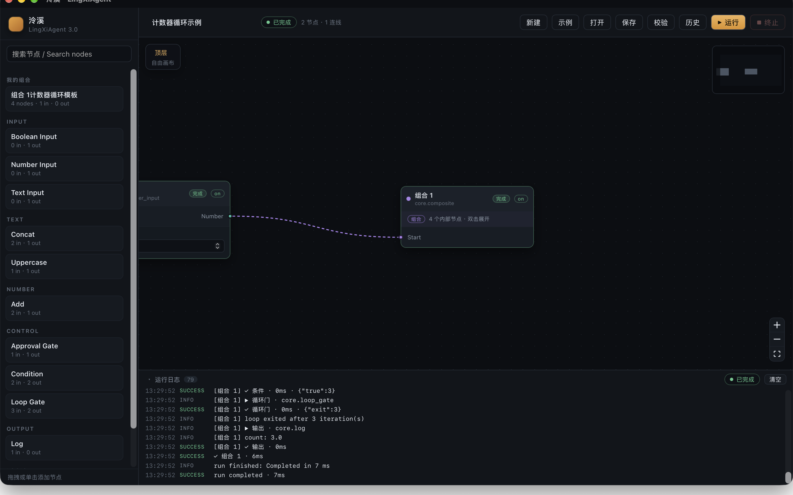

# 泠溪 · LingXiAgent 3.0

跨平台、节点式 Agent 工作流平台。Phase 0 建立 Rust 运行时 + Tauri 2 桌面壳 + React Flow 画布；Phase 1.1 加入条件分支与可预算、可取消的受控循环；Phase 1.1.1 用带避障的自定义路由替换默认边渲染；Phase 1.2 加入事件序号、SQLite 运行历史与刷新重连；Phase 1.2.1 补上单实例保护与实时/持久化事件的统一脱敏；Phase 1.3 加入可展开、可编辑、可复用、由 Rust 分层执行的组合节点与本地模板。工作流是可序列化 JSON，执行全部在 Rust 侧。



## 当前状态

- 分支：`rewrite/3.0`（从 `rewrite/2.0` 的 `c886ba7` 起）
- 阶段：Phase 1.3 — Composite Node / Subgraph，不含真实 LLM 推理
- 验收：macOS 全项通过；Windows / Linux CI 编译与单测通过，运行行为**未验收**
- 测试：`cargo test --workspace` 77 passed；前端 `tsc` + `vite build` 通过；事件重放 6 passed；路由 13 passed；组合 8 passed

## 技术栈

| 层 | 选型 |
| --- | --- |
| 运行时 | Rust（workspace，无 Tauri 依赖） |
| 桌面壳 | Tauri 2 |
| 前端 | React 18 + TypeScript 5（strict） |
| 画布 | `@xyflow/react` 12 |
| 存储 | 工作流 JSON 文件 + SQLite 运行历史 |

## 仓库结构

```
crates/lingxi-spec/      工作流模型、节点规格、校验（纯数据，无 IO）
crates/lingxi-runtime/   执行引擎、控制调度器、内置节点、事件、能力策略、交互总线
apps/desktop/            React UI + Tauri 壳
  src/                   画布、节点库、日志、对话框、transport
  src-tauri/             17 个 command、工作流存储、SQLite 运行库、事件桥
Docs/phase-0/            基础架构、节点规格、接口、测试、已知问题
Docs/phase-1.1/          控制流设计、测试与验收记录
Docs/phase-1.1.1/        智能连线设计、测试与验收记录
Docs/phase-1.2/          运行持久化设计、测试与验收记录
Docs/phase-1.2.1/        单实例保护与脱敏一致性设计、测试与验收记录
Docs/phase-1.3/          组合节点、子图协议、分层执行与模板设计/验收
Docs/reference/2.0/      2.0 历史文档（只读参考）
```

依赖方向严格单向：`lingxi-spec` ← `lingxi-runtime` ← `src-tauri`。运行时不知道窗口存在。

## 快速开始

需要 Rust ≥ 1.90（Tauri 2.12 的实际 MSRV）、Node ≥ 20、pnpm 9。

```bash
pnpm -C apps/desktop install
cargo test --workspace
pnpm -C apps/desktop tauri dev
```

浏览器里单独调 UI（mock transport，不启动 Rust）：

```bash
pnpm -C apps/desktop dev   # http://localhost:1420
```

打包当前平台：

```bash
pnpm -C apps/desktop tauri build
```

Linux 需要 `libwebkit2gtk-4.1-dev` 等系统包，详见 `Docs/phase-0/04-testing-and-acceptance.md`。

## 已实现

- ComfyUI 式布局：左侧节点库、中央自由画布、右上运行/终止、底部可收起日志
- 节点创建（拖入/点击）、移动、缩放、删除、连线、断线、参数内联编辑
- 工作流保存 / 打开 / 删除，视口一并持久化
- Rust 校验并返回结构化问题（34 个稳定 code，含 6 个循环/控制边规则、8 个子图规则）
- Rust 顺序执行：普通 DAG 走 Kahn 拓扑序，含控制节点的图走 token/activation 调度器；支持取消、失败隔离、禁用节点、能力拒绝
- 条件分支（Condition）与受控循环（Loop Gate）：显式预算、迭代计数、超时、预算耗尽失败、取消中断
- 自定义边路由：按实测节点矩形避障、反向边外侧绕行、圆角正交、平行边分道、无解 fallback，支持拖拽/缩放/保存重载
- 运行时事件流：每次运行内连续 `seq`、节点状态、迭代/激活编号、日志、交互请求
- 交互节点（Approval Gate）批准/拒绝，运行暂停等待
- SQLite 持久化运行记录、事件与终态；刷新后重新连接活动运行，按 `seq` 去重、补洞、恢复日志与节点状态
- 应用异常退出后，未完成运行标记为 `interrupted`，不伪装完成、不自动重跑；支持运行列表、详情与历史事件
- 单实例保护：同一数据目录只允许一个桌面进程，第二个实例在打开运行库前安静退出，不破坏第一个实例的运行记录
- 实时与持久化事件共用同一脱敏函数，顶层与嵌套输出一致；重复脱敏幂等；数据库写入失败显式告警并取消运行
- 11 个内置节点：Boolean Input、Condition、Loop Gate、Counter、Text Input、Number Input、Uppercase、Concat、Add、Approval Gate、Log
- 组合节点（Composite）：多选封装/解组、自动端口映射、控制边、双击展开与面包屑、可编辑内部画布，运行时按实例分层执行
- 组合模板：本地保存/插入/删除，实例化重映射全部节点与定义 ID；复制组合时深拷贝定义闭包，编辑副本不影响原定义
- 子图静态校验：检查端口绑定、递归、内部循环、控制边穿越与嵌套循环限制；非法结构在运行前拒绝

## 文档

- [2.0 复用审计](Docs/phase-0/00-reuse-audit.md)
- [架构说明](Docs/phase-0/01-architecture.md)
- [Node Specification v1](Docs/phase-0/02-node-spec-v1.md)
- [运行时接口](Docs/phase-0/03-runtime-interfaces.md)
- [Phase 1.1 控制流设计](Docs/phase-1.1/01-design.md)
- [Phase 1.1 测试与验收](Docs/phase-1.1/02-testing-and-acceptance.md)
- [Phase 1.1.1 智能连线设计](Docs/phase-1.1.1/01-design.md)
- [Phase 1.1.1 测试与验收](Docs/phase-1.1.1/02-testing-and-acceptance.md)
- [Phase 1.2 运行持久化设计](Docs/phase-1.2/01-design.md)
- [Phase 1.2 测试与验收](Docs/phase-1.2/02-testing-and-acceptance.md)
- [Phase 1.2.1 单实例与脱敏设计](Docs/phase-1.2.1/01-design.md)
- [Phase 1.2.1 测试与验收](Docs/phase-1.2.1/02-testing-and-acceptance.md)
- [Phase 1.3 组合节点设计](Docs/phase-1.3/01-design.md)
- [Phase 1.3 测试与验收](Docs/phase-1.3/02-testing-and-acceptance.md)
- [Phase 0 测试与验收](Docs/phase-0/04-testing-and-acceptance.md)
- [Phase 0 已知问题](Docs/phase-0/05-known-issues.md)

## 设计约束

- 不内置固定 Agent Loop；节点即执行单元，循环由 Loop Gate 与用户连边组合
- 前端不执行工作流，只编辑与提交命令
- 拖动/缩放等高频交互不调用 Rust
- 核心不依赖 macOS 专属能力
- 普通节点必须经过 `CapabilityPolicy`，当前生产策略为 `AllowAll`，权限 UI 尚未实现
- 不直接移植 2.0 Swift 代码；只复用协议与概念，见审计文档

## 许可证

见 [LICENSE](LICENSE)、[LICENSE-CORE](LICENSE-CORE)、[LICENSE-FRONTEND](LICENSE-FRONTEND)、[LICENSE-ABI](LICENSE-ABI)。
