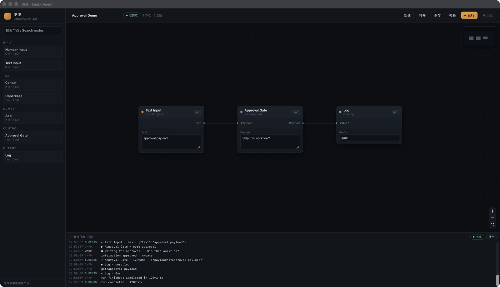

# 泠溪 · LingXiAgent 3.0

跨平台、节点式 Agent 工作流平台。Phase 0 完成基础框架：Rust 运行时 + Tauri 2 桌面壳 + React Flow 画布，工作流是可序列化 JSON，执行全部在 Rust 侧。



## 当前状态

- 分支：`rewrite/3.0`（从 `rewrite/2.0` 的 `c886ba7` 起）
- 阶段：Phase 0 — 框架与编辑器，不含真实 LLM 推理
- 验收：macOS 全项通过；Windows / Linux CI 编译与单测通过，运行行为**未验收**
- 测试：`cargo test --workspace` 21 passed；前端 `tsc` + `vite build` 通过

## 技术栈

| 层 | 选型 |
| --- | --- |
| 运行时 | Rust（workspace，无 Tauri 依赖） |
| 桌面壳 | Tauri 2 |
| 前端 | React 18 + TypeScript 5（strict） |
| 画布 | `@xyflow/react` 12 |
| 存储 | JSON 文件（SQLite 预留，Phase 0 未引入） |

## 仓库结构

```
crates/lingxi-spec/      工作流模型、节点规格、校验（纯数据，无 IO）
crates/lingxi-runtime/   执行引擎、内置节点、事件、能力策略、交互总线
apps/desktop/            React UI + Tauri 壳
  src/                   画布、节点库、日志、对话框、transport
  src-tauri/             9 个 command、工作流存储、事件桥
Docs/phase-0/            架构、节点规格、接口、测试、已知问题
Docs/reference/2.0/      2.0 历史文档（只读参考）
```

依赖方向严格单向：`lingxi-spec` ← `lingxi-runtime` ← `src-tauri`。运行时不知道窗口存在。

## 快速开始

需要 Rust ≥ 1.90（Tauri 2.12 的实际 MSRV）、Node ≥ 20、pnpm 9。

```bash
pnpm -C apps/desktop install
cargo test --workspace
pnpm -C apps/desktop tauri dev
```

浏览器里单独调 UI（mock transport，不启动 Rust）：

```bash
pnpm -C apps/desktop dev   # http://localhost:1420
```

打包当前平台：

```bash
pnpm -C apps/desktop tauri build
```

Linux 需要 `libwebkit2gtk-4.1-dev` 等系统包，详见 `Docs/phase-0/04-testing-and-acceptance.md`。

## 已实现

- ComfyUI 式布局：左侧节点库、中央自由画布、右上运行/终止、底部可收起日志
- 节点创建（拖入/点击）、移动、缩放、删除、连线、断线、参数内联编辑
- 工作流保存 / 打开 / 删除，视口一并持久化
- Rust 校验并返回结构化问题（20 个稳定 code）
- Rust 顺序执行（Kahn 拓扑序），支持取消、失败隔离、禁用节点、能力拒绝
- 运行时事件流：节点状态、日志、交互请求
- 交互节点（Approval Gate）批准/拒绝，运行暂停等待
- 7 个内置节点：Text Input、Number Input、Uppercase、Concat、Add、Approval Gate、Log

## 文档

- [2.0 复用审计](Docs/phase-0/00-reuse-audit.md)
- [架构说明](Docs/phase-0/01-architecture.md)
- [Node Specification v1](Docs/phase-0/02-node-spec-v1.md)
- [运行时接口](Docs/phase-0/03-runtime-interfaces.md)
- [测试与验收](Docs/phase-0/04-testing-and-acceptance.md)
- [已知问题](Docs/phase-0/05-known-issues.md)

## 设计约束

- 不内置固定 Agent Loop；节点即执行单元
- 前端不执行工作流，只编辑与提交命令
- 拖动/缩放等高频交互不调用 Rust
- 核心不依赖 macOS 专属能力
- 普通节点必须经过 `CapabilityPolicy`，当前生产策略为 `AllowAll`，权限 UI 尚未实现
- 不直接移植 2.0 Swift 代码；只复用协议与概念，见审计文档

## 许可证

见 [LICENSE](LICENSE)、[LICENSE-CORE](LICENSE-CORE)、[LICENSE-FRONTEND](LICENSE-FRONTEND)、[LICENSE-ABI](LICENSE-ABI)。
